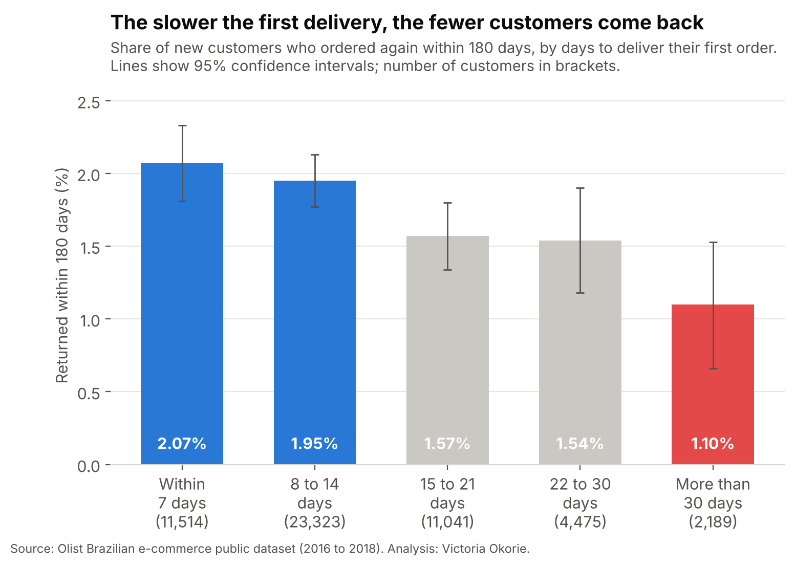

# The First Delivery Decides: Delivery Speed and Repeat Purchase in E-commerce

**An end-to-end growth and retention analytics project by Victoria Okorie**
Python · Structured Query Language (SQLite) · Statistics and survival analysis · Excel · Tableau · Data storytelling

> **The question:** Does a slow first delivery stop a new customer from ever buying again? And once a customer has bought, when is the window to win their second order?

📖 **Read the data story:** [`story/The-First-Delivery-Decides.html`](story/The-First-Delivery-Decides.html) (download and open in a browser) or the [PDF version](story/The-First-Delivery-Decides.pdf)
📊 **Interactive dashboard:** Add your Tableau link here



---

## Why this matters

Most e-commerce analysis looks at what customers buy. Far less looks at what happens **after** they buy. On the Olist marketplace, 97 out of every 100 customers ordered only once, so the few who return are worth a lot: in this data, returning customers spent about 126 reais more over the period than one-time buyers.

Growth teams usually treat retention as a marketing problem. This project tests whether it starts earlier, in operations: with how long the very first parcel takes to arrive.

## Key findings

| # | Finding | Evidence |
|---|---|---|
| 1 | **Faster first deliveries bring more customers back.** Customers delivered within 7 days returned at 2.07% within 180 days; those who waited more than 30 days returned at 1.10%. | Chi-square test across 5 speed bands, p = 0.001 |
| 2 | **Each extra week of waiting cuts the odds of a return by about 11%**, after controlling for region, order value, shipping share, number of items, payment type, category and season. | Logistic regression, odds ratio 0.89 (95% interval 0.83 to 0.95) |
| 3 | **It is the wait, not the broken promise.** Delivery after the promised date was not significant once other factors were controlled (odds ratio 0.78, interval 0.55 to 1.09), and added nothing once waiting time was known. Olist's estimates were cautious: the typical customer was promised 25 days and received the parcel in 11. | Logistic regression models C and D |
| 4 | **Slow deliveries show up in reviews first.** 63% of customers who waited more than 30 days gave 1 or 2 stars, against 7.5% of those delivered within a week. | 92,628 reviewed first orders |
| 5 | **The second purchase window is the first 60 days after delivery.** The chance of a second order is 0.54% in days 0 to 30 and 0.34% in days 31 to 60, then settles at about 0.19% a month after day 90. | Kaplan-Meier hazard, 93,185 delivered customers |
| 6 | **The second order is the gate to loyalty.** A first-time customer has a 1.7% chance of ordering again within 180 days; after a second order, the chance of a third is 8.2%, about 4.7 times higher. | Kaplan-Meier estimates |

## The data

- **Source:** Olist Brazilian e-commerce public dataset, released by Olist on GitHub (github.com/olist/work-at-olist-data, open-source Massachusetts Institute of Technology licence) and also published on Kaggle as "Brazilian E-Commerce Public Dataset by Olist".
- **What it is:** 99,441 real, anonymised orders from 96,096 customers placed on Brazilian marketplaces between September 2016 and August 2018, across 8 linked tables: orders, customers, order items, payments, reviews, products, sellers and category translations.
- **Not used:** the geolocation table (61 megabytes), because state-level location was enough for this question.

## What I did

### 1. Cleaned and reshaped the data (Python, pandas) → [`python/01_clean_data.py`](python/01_clean_data.py)

| Step | Why it matters |
|---|---|
| Used `customer_unique_id`, not `customer_id`, to identify people | Olist creates a new customer_id for every order. Using it would make every customer look like a one-time buyer. |
| Removed 20 orders after August 2018 | The data trails off; partial months would distort follow-up. |
| Kept the latest review where an order had several (547 orders) | One review per order. |
| Calculated delivery days, promised days and days early or late | The core measures of the delivery experience. |
| Counted a "return" only if the new order was placed **after** the first parcel arrived | 1,263 later orders were placed before delivery (mostly same-day split baskets) and could not have been influenced by it. |
| Built a fair study group: delivered first orders with at least 180 days of follow-up | Recent customers would otherwise look disloyal only because they had less time. 52,542 customers. |
| Built one row per customer from their first order, plus their later history | Ready for analysis, dashboards and survival curves. |

### 2. Analysed it with Structured Query Language → [`structured-query-language/`](structured-query-language/)

A star schema in SQLite (two fact tables and two lookup tables) and 12 queries using joins, `CASE`, common table expressions, window functions (`SUM() OVER`, running totals, `RANK()`) and `HAVING`, ending with automated data-quality checks that all return zero problems.

### 3. Tested it statistically → [`python/03_analysis.ipynb`](python/03_analysis.ipynb)

- **Chi-square tests** to check whether gaps between groups could be chance.
- **Logistic regression** (five models) to separate delivery speed from lateness, reviews, region, price, product, payment method and season.
- **Kaplan-Meier survival analysis** on all 93,185 delivered customers, which correctly handles customers followed for different lengths of time, to confirm the speed effect and to measure the second purchase window and the loyalty gate.

### 4. Built dashboards → [`dashboard/`](dashboard/)

- **Excel:** live `COUNTIFS` and `AVERAGEIFS` formulas, a second purchase window sheet and a what-if planner for faster deliveries and win-back campaigns.
- **Tableau Public:** six charts, three number tiles and filters by region and category. Build steps: [`dashboard/Tableau-Build-Guide.md`](dashboard/Tableau-Build-Guide.md).

### 5. Told the story → [`story/`](story/)

A feature-style data journalism article with interactive charts (hover tooltips, light and dark mode, a table view), in which every number is filled in automatically from the analysis outputs.

## What a growth team should do

1. **Protect the first delivery.** Route first-time buyers to the fastest sellers and carriers, especially in the North and Northeast, where first deliveries took about 20 days against 11 in the Southeast.
2. **Days 3 to 10 after delivery:** thank-you and how-to-use message; for any first order that took more than three weeks, add an apology and a small credit toward the next order.
3. **Days 14 to 30:** the first personalised offer, by first-purchase category. This is the period with the highest chance of return.
4. **Days 45 to 60:** one stronger reminder while the window is still open. After day 90, move to low-cost newsletters only.
5. **Make "second order rate" the main retention goal**, and plan a third-order nudge about 50 days after the second order (the median gap in this data).

**Size of the prize (an estimate, not a promise):** if every customer whose first delivery took more than 14 days had returned at the rate of customers delivered in 8 to 14 days, the study group would have had about 79 more returning customers, roughly 8% more. That is modest on a marketplace where about 2 in 100 customers return, but it comes from levers a business already controls. Any change should be tested with a holdout group first.

## Limitations

- **Association, not proven cause.** Controls reduce, but cannot remove, the chance that something unmeasured explains the link. A randomised test of faster first deliveries would settle it.
- **Repeat purchase is rare** (about 1,800 returning customers), so some groups are small. Confidence intervals are shown throughout.
- **No marketing campaign data**, so the timing plan comes from natural return behaviour and must be tested.
- **One marketplace, one country, 2016 to 2018.**

## Project structure

```
├── README.md
├── story/                         Data journalism article (HTML and PDF) and its template
├── data/
│   ├── raw/                       Original Olist files
│   └── clean/                     fact_customers, fact_orders, dim_state, dim_category, cleaning_log.txt
├── python/
│   ├── 01_clean_data.py           Cleaning and feature building
│   ├── 02_run_sql.py              Builds the database and runs every query
│   ├── 03_analysis.ipynb          Statistics, survival analysis and charts
│   ├── build_notebook.py          Builds and runs the notebook
│   ├── 04_build_excel_dashboard.py
│   └── 05_build_story.py          Fills the article with the latest numbers
├── structured-query-language/
│   ├── 01_create_tables.sql       Star schema
│   └── 02_analysis_queries.sql    12 analysis queries
├── outputs/                       Charts, query results and model tables
└── dashboard/                     Excel dashboard and Tableau data files
```

## How to run it

```bash
python3 -m pip install -r requirements.txt
python3 python/01_clean_data.py
python3 python/02_run_sql.py
python3 python/build_notebook.py
python3 python/04_build_excel_dashboard.py
python3 python/05_build_story.py
```

---

*Victoria Okorie · Honours Bachelor of Science, University of Toronto · Growth, marketing and data analytics*
